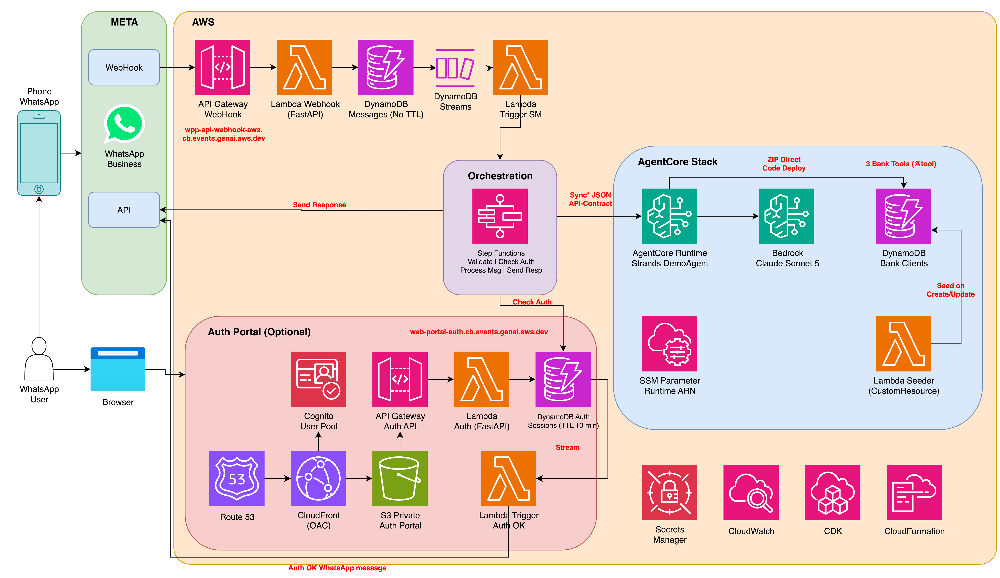
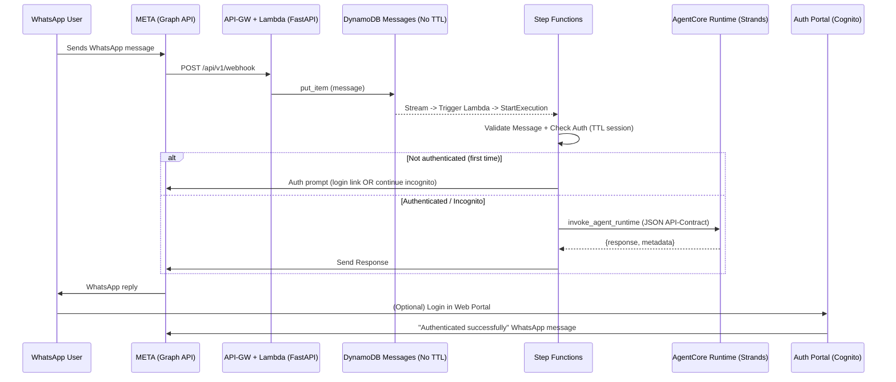

# :scroll: AWS-WHATSAPP-AGENTCORE-BACKEND :scroll:


My Serverless WhatsApp chatbot on AWS, powered by **Amazon Bedrock AgentCore Runtime** and **Strands Agents**, with an optional **Cognito Auth Portal** for authenticated (auth-based) tools.

- Financial Bank Agent demo ("DemoAgent") with direct Python tools (`@tool`), easy to swap for ANY agent.
- Optional web authentication flow: login in the browser to unlock the FULL set of agent tools, or continue as incognito user with a reduced (public) subset.

> Feel free to clone it and extend it to your own company information/data (at your own risk/responsibility)

## Detailed Tutorials :bulb:

- [YouTube Tutorial by Santi: Chatbot de WhatsApp Serverless en AWS con Generative-AI (Spanish)](https://youtu.be/9LMtXSYBZ-c)
- [SLIDES_BoyaConf_2024_Chatbot_WhatsApp_AWS](./assets/SLIDES_BoyaConf_2024_Chatbot_WhatsApp_AWS.pdf)

## Getting Started :rocket:

All prerequisites (META account, AWS Secret, DNS, `.env`) and deployment steps are in:

- [GETTING_STARTED.md](./GETTING_STARTED.md)

> ⚠️ MANDATORY prerequisites before deploying: 1/ a **Route53 Hosted Zone** you own (REPLACE `hosted_zone_name` + `hosted_zone_id` in `infrastructure/cdk.json` — the defaults are the author's own zone), 2/ the **AWS Secret** `/prod/aws-whatsapp-chatbot` created manually, and 3/ your local **`.env`** file (copy from `.env.example`).

## Architecture :memo:

 <br>

Key design decisions:

- **API Gateway + Lambda (FastAPI)** receives the META WebHook with custom DNS (`wpp-api-webhook-aws.cb.events.genai.aws.dev`) and validates the verify-token against AWS Secrets Manager.
- **DynamoDB messages table** stores every WhatsApp message **forever (NO TTL)**, and its **Stream** asynchronously triggers the processing State Machine.
- **Step Functions (EXPRESS)** orchestrates: `Validate Message -> Check Auth -> [Fetch Audio -> Transcribe Audio] -> Process Message -> Send Response` (plus TBD placeholders for Image/Video).
- **Audio (voice notes / MP3) support**: audio messages arrive at the webhook with a META **media ID** (`audio_id`). The State Machine **fetches** it (META media URL -> binary download -> S3) and runs a **SYNC Amazon Transcribe job** (auto language detection ES/EN, with detailed step-by-step logs). The transcribed text is then **re-utilized** as the Agent's prompt in `Process Message`.
- **Process Message** invokes the **AgentCore Runtime** via `invoke_agent_runtime` with a structured **JSON API-Contract** (`prompt` + `metadata.authenticated/username/phone_number`). The Runtime ARN is resolved dynamically from an **SSM Parameter** (name injected as ENV-VAR).
- **AgentCore Runtime** runs the **Strands "DemoAgent"** (Financial Bank Agent) deployed via **direct code deploy (ZIP)** — no Docker image — using **Claude Sonnet 5** on Bedrock (configurable in `cdk.json`).
- **Auth Portal (optional, `auth_enabled` in cdk.json)**: Cognito login at `web-portal-auth.cb.events.genai.aws.dev` (CloudFront + private S3) creates a 10-minute auth session in DynamoDB (TTL), whose Stream sends the "authenticated successfully" WhatsApp confirmation.
- **1:1 USER<->WHATSAPP mapping**: permanent items (`USERNAME#<user>/MAPPING` and `USER#<phone>/MAPPING`) in the auth-sessions table, seeded by the CustomResource and self-healed on every portal login. The Auth API resolves the phone from the Cognito `phone_number` attribute with fallback to the mapping (no orphan sessions).
- **Identity footer + privacy**: every outgoing message ends with a one-line identity footer; unauthenticated users are ALWAYS shown (and treated) as fully incognito.

### End-to-End Flow (Mermaid)



## Project Structure :open_file_folder:

```
aws-whatsapp-agentcore-backend/
├── Makefile                    # Root orchestrator (layers + agent package)
├── agent/                      # Strands DemoAgent (AgentCore ZIP direct code deploy)
│   ├── main.py                 # BedrockAgentCoreApp entrypoint (JSON API-Contract)
│   └── tools/bank_tools.py     # Bank tools as @tool (direct Python, no Lambdas)
├── backend/                    # Lambda source code
│   ├── auth/                   # Auth API (FastAPI): Cognito token -> auth session
│   ├── common/                 # Models (Pydantic v2), helpers, enums, logger
│   ├── seeder/                 # CustomResource handler (DDB + Cognito seeding)
│   ├── state_machine/          # Step Function steps + META/AgentCore integrations
│   ├── trigger/                # DDB Streams triggers (SM start + auth-ok message)
│   └── whatsapp_webhook/       # WhatsApp Webhook API (FastAPI)
├── frontend/                   # Auth Portal static site (Cognito login)
├── infrastructure/             # AWS CDK (Python)
│   ├── cdk.json                # ALL configurations (app_config per environment)
│   └── cdk/
│       ├── app.py              # 3 stacks (auth portal is conditional)
│       ├── helpers/            # Tagging helper
│       └── stacks/             # agentcore / chatbot-api / auth-portal stacks
├── lambda-layers/              # Common Lambda Layer (FastAPI, PowerTools v3, ...)
└── tests/unit/                 # FastAPI, state machine, agent tools, CDK tests
```

## Stacks :bricks:

| Stack                                | Purpose                                                                                                  |
| ------------------------------------ | -------------------------------------------------------------------------------------------------------- |
| `agentcore-aws-wpp-{env}-stack`      | AgentCore Runtime (Strands DemoAgent, ZIP deploy), bank-clients DynamoDB + seeder CR, SSM Parameter (ARN) |
| `aws-wpp-chatbot-api-{env}`          | API-GW (custom DNS) + Webhook Lambda, messages DynamoDB (no TTL), Step Functions, triggers                |
| `aws-wpp-auth-portal-{env}`          | (Only if `auth_enabled=true`) Cognito, Auth API (custom DNS), auth-sessions DynamoDB (TTL), CloudFront+S3  |

## Hyperpersonalization (User Profile) :sparkles:

The chatbot ALWAYS knows who it's talking to:

- **Automatic profile loading (authenticated users ONLY)**: on every incoming message, the `Check Auth` step resolves the user identity (`phone -> USER#<phone>/MAPPING -> user_email`) and loads the profile (name, `nickname`, and `hyperpersonalization` key data like city, preferred channel, financial goals, tone) from the `bank-clients` DynamoDB table. The profile travels to the Agent inside the JSON API-Contract (`metadata.profile`) and gets injected into the system prompt.
- **Privacy first**: until the auth process completes, the user stays FULLY incognito — no name in the footer and no profile/personalization sent to the Agent.
- **`obtener_perfil_usuario` tool**: the Agent can also re-query the profile on demand (authenticated users).
- **Identity footer**: ALL outgoing WhatsApp messages include a one-line footer showing the auth status and identity: `🔐 Autenticado: Sí ✅ | 👤 Santiago Garcia (Santi)` (authenticated) or `🔐 Autenticado: No | 👤 Incógnito 🕵️` (not authenticated).
- **Seeded data**: the profiles (nickname + hyperpersonalization) are seeded automatically by the CustomResource from `infrastructure/cdk/stacks/seed_data.py`.

## Customize the Agent :robot:

The "DemoAgent" is a generic **Financial Bank Agent**, but you can turn it into ANY type of agent by updating (user-side changes only):

1. **`agent/main.py`**: update the `SYSTEM_PROMPT` (persona/instructions) and the tools wiring in `_build_agent()`.
2. **`agent/tools/`**: add/replace the `@tool` functions with your own business logic (each current tool has a `# TODO SANTI - Evaluate migration to AgentCore MCP GW Approach` marker for a future MCP Gateway migration).
3. **`infrastructure/cdk.json`**: update `bedrock_model_id`, `bot_name`, `language`, and `agentcore_runtime_name` as needed.
4. Re-deploy: `cd agent && make clean && cd .. && poetry run poe deploy` (the ZIP package is rebuilt automatically).

The JSON API-Contract (`prompt` + `metadata`) stays the same, so the WhatsApp workflow keeps working with any agent.

## Auth Flow (Optional) :closed_lock_with_key:

Controlled by `auth_enabled` in `infrastructure/cdk.json`:

- **`auth_enabled: true`**: unauthenticated users receive a WhatsApp message asking them to LOGIN in the Web Portal (`https://web-portal-auth.cb.events.genai.aws.dev`) **OR** continue as **Incognito User** (reduced subset of tools). After Cognito login, the auth session (TTL 10 min) unlocks the full toolset and the user gets a WhatsApp confirmation.
- **`auth_enabled: false`**: the Auth Portal Stack is NOT deployed, and the State Machine bypasses the auth check (everyone is an incognito user).

Auth session lifecycle (DynamoDB `auth-sessions` table):

| Item | TTL | Purpose |
| --- | --- | --- |
| `USER#<phone> / AUTH` | 10 min | Active session (written by the Auth API after Cognito login) |
| `USER#<phone> / AUTH#PROMPTED` | 10 min | Marker so the login prompt is only sent once per window |
| `USERNAME#<user> / MAPPING` + `USER#<phone> / MAPPING` | none (permanent) | 1:1 USER<->WHATSAPP mapping (seeded + self-healed) |

## Demo Users :busts_in_silhouette:

Seeded automatically by the CustomResources from `infrastructure/cdk/stacks/seed_data.py` (Cognito + bank-clients + mappings) with 100% FAKE/SIMULATED data (`*@example.com` users). The main demo user's REAL WhatsApp number and the demo users password come from the local **`.env` file** (copy `.env.example` -> `.env` BEFORE deploying; it is gitignored and must NEVER be committed).

> IMPORTANT: for the E2E flow to work, the `DEMO_USER_PHONE_NUMBER` in `.env` MUST be a real WhatsApp number ALLOWLISTED in your META test app (META error `#131030` otherwise).

## State Machine Process :fallen_leaf:

`Validate Message -> Check Auth -> (Choice) ->`
- `text` -> `Process Message`
- `audio/voice` -> `Fetch Audio (META media) -> Transcribe Audio (Sync) -> Process Message` (the transcription is re-utilized as the Agent prompt)
- `image/video` -> `TBD placeholders`
- `auth_prompt` -> straight to `Send Response`

`-> Send Response -> Success`

- **Audio pipeline**: `Fetch Audio` downloads the media by its META `audio_id` (metadata URL + Bearer download) into the private S3 audio bucket (30-day lifecycle); `Transcribe Audio` runs a SYNC Amazon Transcribe job (polling with logs, auto language ES/EN).
- Retries with exponential backoff on `Fetch Audio`, `Process Message` and `Send Response`.
- Failure handling via catch-all towards `Process Failure`.
- EXPRESS State Machine with FULL CloudWatch logging (as all other components: API-GW access logs, Lambda PowerTools DEBUG logs, AgentCore observability).

## Tests :test_tube:

```bash
poetry run poe test-unit    # unit tests + coverage (FastAPI, steps, tools, CDK)
poetry run poe black-check  # code formatting checks
poetry run poe synth        # CDK synth (validates the 3 stacks)
```

## Manual Steps (Only Once) :raised_hand:

- [GETTING_STARTED.md](./GETTING_STARTED.md) -> Full prerequisites (META account, AWS Secret, DNS, Bedrock model access).
- [WHATSAPP_CONFIGURATION README](./docs/WHATSAPP_CONFIGURATION.md) -> Meta project/token setup.
- [AWS_CONFIGURATION README](./docs/AWS_CONFIGURATION.md) -> AWS Secret creation commands.

## Shoutouts 🙌

Thanks for all the inspiration and guidance on the Generative AI journey:

- [elizabethfuentes12](https://github.com/elizabethfuentes12) -> Gracias, Eli por inspirarme a ser un Developer Advocate!
- [micheldirk](https://medium.com/@micheldirk) -> Thanks Michel for the inspiration for the low-level CDK constructs!

## Author 🎹

### Santiago Garcia Arango

<table border="1">
    <tr>
        <td>
            <p align="center">Curious Solutions Architect experienced in DevOps and passionate about advanced cloud-based solutions and deployments in AWS. I am convinced that today's greatest challenges must be solved by people that love what they do.</p>
        </td>
        <td>
            <p align="center"></p>
        </td>
    </tr>
</table>

## LICENSE

Copyright 2026 Santiago Garcia Arango.
